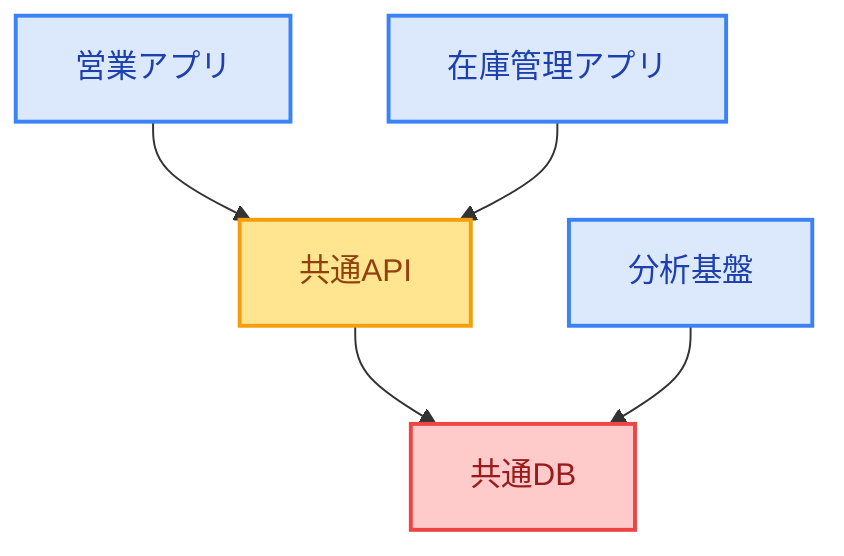

# network-impact-analyzer 詳細設計書

## 1. 概要

Network Impact Analyzer

目的： システム同士の依存関係を分析し、特定のシステムで障害が発生した場合の影響範囲や、障害対策の優先順位を可視化する。

## どんな分析ができる？

構成図

矢印は「依存している側 → 依存先」を表します。例えば、営業アプリ → 共通API は、営業アプリが共通APIに依存するという意味です。

このネットワークで「共通DBに障害が起きたら？」という問いを分析します。

## 2. システム構成

## 3. データ設計

## 4. クラス設計

## 5. 処理設計

## 6. エラー処理

## 7. 入出力仕様

## 8. テストとの対応

